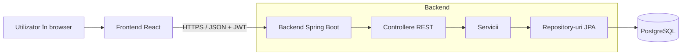

# Arhitectură

Aplicația folosește o arhitectură client-server pe trei straturi: interfața web, API-ul REST și baza de date.

## Diagramă

## Componente

| Componentă | Rol |
|---|---|
| Frontend (React) | Afișează interfața, apelează API-ul, desenează graficele cu Chart.js. |
| Controllere REST | Primesc cererile HTTP, validează intrarea, returnează JSON. |
| Servicii | Conțin logica: calculul progresului, sesiunile de timp, statisticile. |
| Repository-uri (Spring Data JPA) | Accesul la baza de date. |
| Securitate (Spring Security + JWT) | Autentificare, autorizare, izolarea datelor pe utilizator. |
| PostgreSQL | Stocarea persistentă. |

## Comunicarea între componente

- Frontend-ul trimite cereri HTTPS cu JSON către `/api/...`. Header-ul `Authorization: Bearer <token>` este obligatoriu, cu excepția login-ului și a înregistrării.
- Controllerele apelează serviciile, iar serviciile folosesc repository-urile. Controllerele nu acced direct la baza de date.
- Statisticile se calculează în backend prin interogări SQL agregate (`GROUP BY` lună / an) și se returnează gata de afișat.

## Exemplu de flux: finalizarea unui task

1. Frontend: `PATCH /api/tasks/{id}/complete`.
2. `TaskController` verifică tokenul și apelează `TaskService.complete(id, userId)`.
3. Serviciul verifică că task-ul aparține utilizatorului, setează statusul și `completedAt`.
4. Progresul obiectivului se calculează la citire: task-uri finalizate / total task-uri.
5. API-ul returnează task-ul actualizat.

## Decizii

- **Monolit, nu microservicii:** proiect mic, echipă mică, deploy simplu.
- **Progres calculat la citire:** evită date duplicate care pot ajunge nesincronizate.
- **JWT:** API fără sesiuni pe server, ușor de folosit din frontend.
