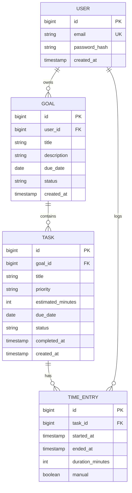

# Model de date

## Diagrama entităților



## Entități

| Entitate | Descriere |
|---|---|
| USER | Contul utilizatorului. |
| GOAL | Un obiectiv; status: `ACTIVE`, `COMPLETED`, `ARCHIVED`. |
| TASK | Un task al unui obiectiv; status: `TODO`, `IN_PROGRESS`, `DONE`; prioritate: `LOW`, `MEDIUM`, `HIGH`. |
| TIME_ENTRY | O sesiune de lucru pe un task, pornită cu cronometrul sau introdusă manual. |

## Valori calculate (nu se stochează)

- **Progres obiectiv** = task-uri `DONE` / total task-uri.
- **Timp real task** = suma `duration_minutes` din `TIME_ENTRY`.
- **Statistici lunare / anuale** = agregări pe `completed_at` și `started_at`.

## Endpoint-uri REST

Toate, în afară de cele de autentificare, cer token JWT.

### Autentificare

| Metodă | Cale | Descriere |
|---|---|---|
| POST | `/api/auth/register` | Creează cont |
| POST | `/api/auth/login` | Returnează token |

### Obiective

| Metodă | Cale | Descriere |
|---|---|---|
| GET | `/api/goals` | Lista obiectivelor cu progres |
| POST | `/api/goals` | Creează obiectiv |
| GET | `/api/goals/{id}` | Detalii obiectiv |
| PUT | `/api/goals/{id}` | Editează obiectiv |
| DELETE | `/api/goals/{id}` | Șterge obiectiv |

### Task-uri

| Metodă | Cale | Descriere |
|---|---|---|
| GET | `/api/goals/{goalId}/tasks` | Task-urile unui obiectiv |
| POST | `/api/goals/{goalId}/tasks` | Creează task |
| GET | `/api/tasks?status=&from=&to=` | Căutare și filtrare |
| PUT | `/api/tasks/{id}` | Editează task |
| PATCH | `/api/tasks/{id}/complete` | Marchează finalizat |
| DELETE | `/api/tasks/{id}` | Șterge task |

### Timp

| Metodă | Cale | Descriere |
|---|---|---|
| POST | `/api/tasks/{id}/timer/start` | Pornește cronometrul |
| POST | `/api/tasks/{id}/timer/stop` | Oprește cronometrul și salvează sesiunea |
| POST | `/api/tasks/{id}/time-entries` | Adaugă timp manual |
| GET | `/api/tasks/{id}/time-entries` | Sesiunile unui task |

### Statistici

| Metodă | Cale | Descriere |
|---|---|---|
| GET | `/api/stats/monthly?year=2026&month=11` | Statistici pentru o lună |
| GET | `/api/stats/yearly?year=2026` | Statistici pentru un an, pe luni |

Exemplu de răspuns pentru `/api/stats/monthly`:

```json
{
  "year": 2026,
  "month": 11,
  "tasksCompleted": 18,
  "totalMinutesWorked": 1900,
  "totalMinutesEstimated": 1680
}
```
