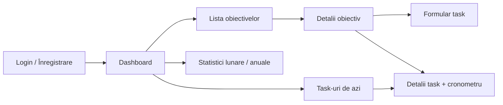

# Wireframe-uri

Wireframe-urile de mai jos sunt schițe low-fidelity în text. Ulterior vom adauga wireframe-uri in figma 

## Flux de navigare



## 1. Login / Înregistrare

```
+------------------------------------+
|          GOAL TRACKER              |
|                                    |
|  Email    [____________________]   |
|  Parolă   [____________________]   |
|                                    |
|  [      Autentificare      ]       |
|  Nu ai cont? Înregistrează-te      |
+------------------------------------+
```

## 2. Dashboard

```
+--------------------------------------------------+
| Goal Tracker   Obiective  Statistici    [Profil] |
+--------------------------------------------------+
| Obiective active                  [+ Obiectiv]   |
|  Licență            [#######---] 70%  3 task-uri |
|  Engleză B2         [###-------] 30%  5 task-uri |
|                                                  |
| Task-uri pentru azi                              |
|  [ ] Scrie capitolul 2        Licență   2h  ▶    |
|  [x] Vocabular unitatea 4     Engleză   1h       |
|                                                  |
| Întârziate (1): Trimite draftul   termen: ieri   |
+--------------------------------------------------+
```

## 3. Detalii obiectiv

```
+--------------------------------------------------+
| < Obiective     Licență              [Editează]  |
| Termen: 30.06.2027      Progres: [#######---] 70%|
+--------------------------------------------------+
| Task-uri                          [+ Task]       |
|  Titlu              Est.  Real  Status    Termen |
|  Capitol 1          4h    5h    Finalizat 12.11  |
|  Capitol 2          6h    2h    În lucru  20.11  |
|  Bibliografie       2h    0h    De făcut  30.11  |
+--------------------------------------------------+
```

## 4. Detalii task cu cronometru

```
+--------------------------------------------------+
| < Licență      Scrie capitolul 2                 |
| Prioritate: Înaltă   Estimat: 6h   Termen: 20.11 |
|                                                  |
|           00:24:13                               |
|      [ Stop ]   [ Finalizează ]                  |
|                                                  |
| Sesiuni de lucru               [+ Timp manual]   |
|  11.11  19:00-20:10   1h 10m                     |
|  10.11  17:30-18:20   50m                        |
+--------------------------------------------------+
```

## 5. Statistici

```
+--------------------------------------------------+
| Statistici      (Lunar) ( Anual )   [Noi 2026 v] |
+--------------------------------------------------+
| Task-uri finalizate: 18   Timp lucrat: 31h 40m   |
| Estimat: 28h   Real: 31h 40m                     |
|                                                  |
|  Task-uri finalizate pe zile / luni              |
|  ▂ ▄ ▇ ▃ ▅ ▂ ▆ ▃ ▁ ▄ ▇ ▅                        |
|  Ian Feb Mar Apr Mai Iun Iul Aug Sep Oct Noi Dec |
+--------------------------------------------------+
```
